# workout.log

A small, fast workout tracker you can install on your phone. Pick a schedule for the day (or build one on the go), tick sets off as you lift, and watch your progress over time. Everything is stored on your device, so it works offline and needs no account or server.

<p align="center">
  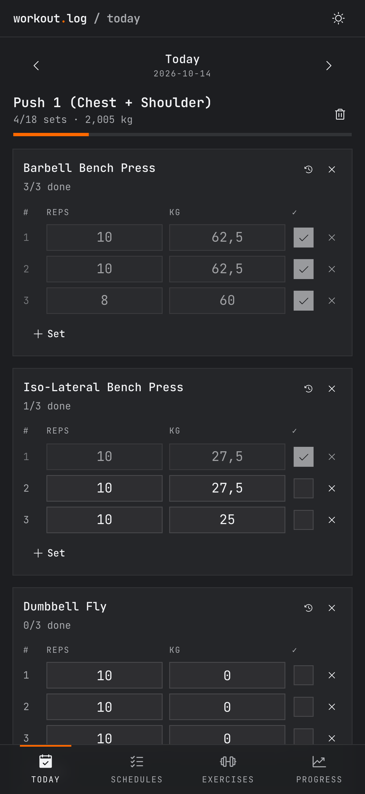
  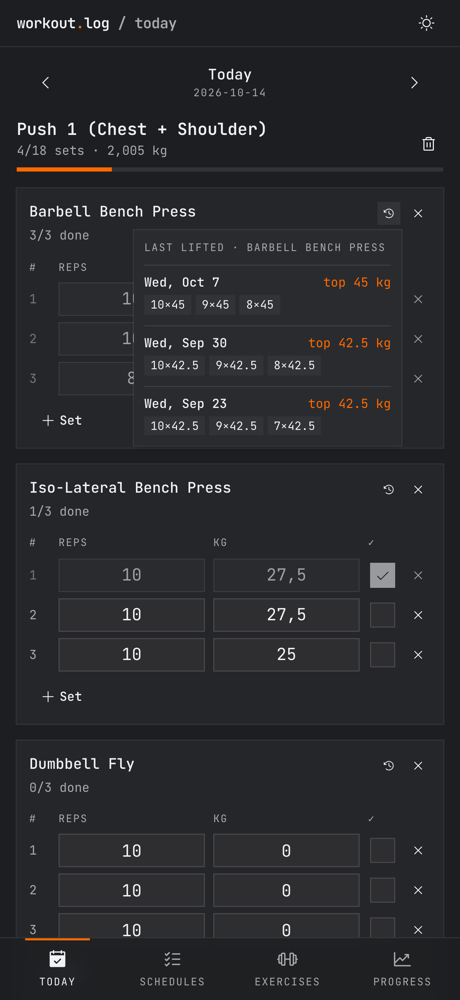
  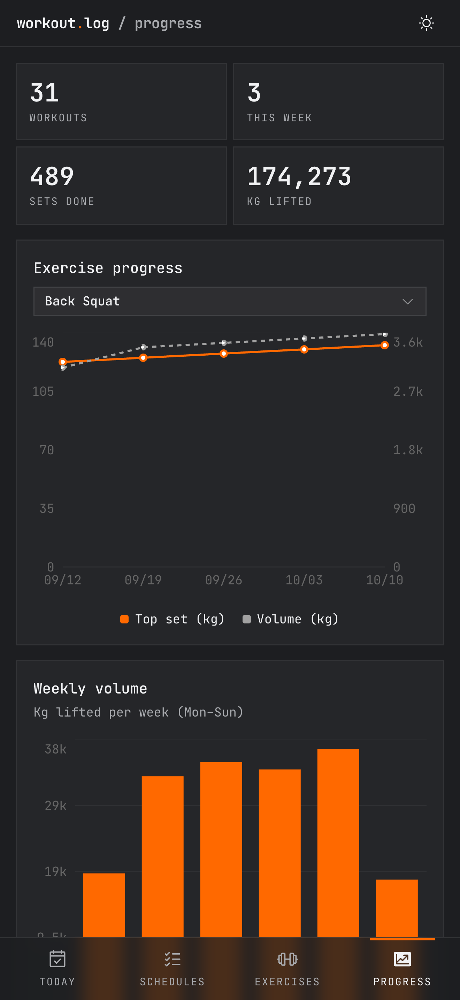
  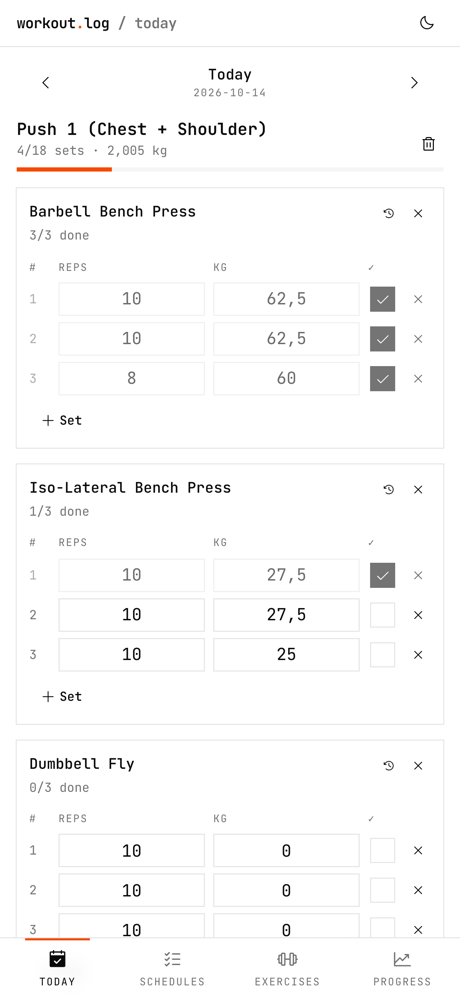
</p>

## Features

- **Daily schedules.** Create named schedules (Push, Pull, Legs…) with preset sets, reps and weights. Start one with a tap, or start a custom workout and add exercises as you go.
- **Log as you lift.** Edit reps and kg per set and tick them off. Every change saves immediately.
- **Finish & lock.** Finish a workout to make it read-only. Reopen it if you finished by mistake.
- **Swipe between days.** Swipe left or right on the Today screen to move through the calendar and review or fill in past workouts.
- **Last lifted weights.** A history button on every exercise shows your last three sessions (sets, reps, top weight) so you know what to lift today.
- **210 built-in exercises** grouped by muscle (Chest, Back, Legs…) in collapsible sections with search. Add, rename or delete your own.
- **Progress charts.** Top set and volume per exercise over time, weekly volume, and lifetime totals. Only sets you ticked count.
- **Demo data.** Load five weeks of sample workouts to preview the charts, and remove them again without touching real data.
- **Installable PWA.** Install prompt on Android and desktop, Add to Home Screen hint on iOS, offline after the first visit.
- **Light and dark mode** that follows your device, with a monospace look built on [shadcn/ui](https://ui.shadcn.com).
- **Responsive.** Bottom tab bar on phones; tabs move to the header with multi-column layouts on tablets and desktops.
- **Backup.** Export and import all data as JSON.

## Screenshots

Captured at iPhone 17 Pro Max size (1320 × 2868) with demo data loaded. All 24 are in [`screenshots/iphone-17-pro-max`](screenshots/iphone-17-pro-max), each in dark and light.

| Pick a schedule | Workout in progress | Exercise picker | Finished workout |
|:-:|:-:|:-:|:-:|
| 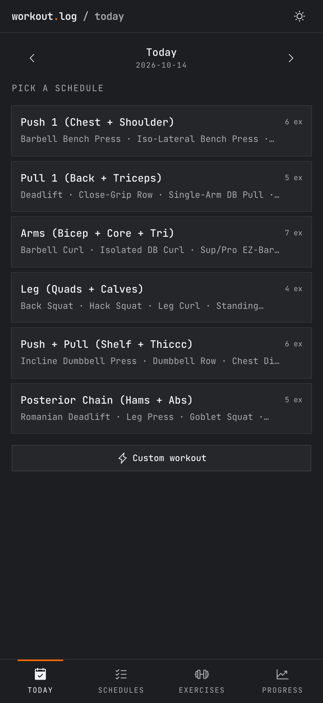 |  | 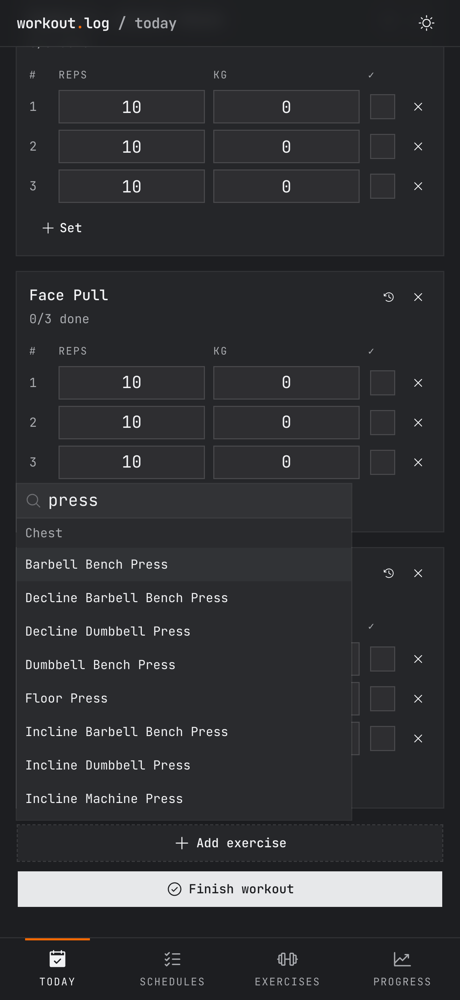 | 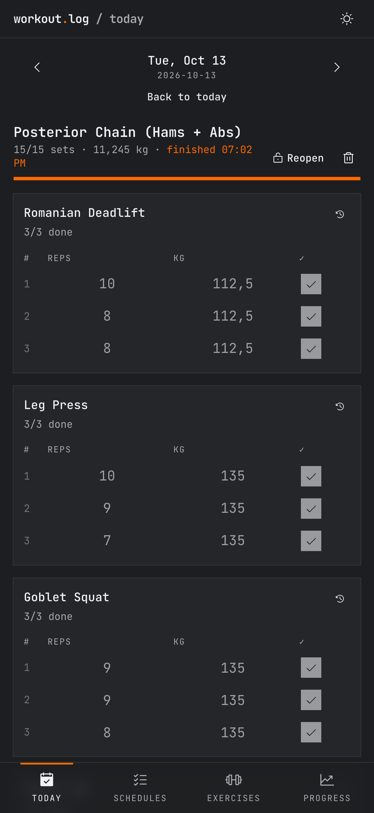 |

| Schedules | Schedule editor | Exercises | Progress |
|:-:|:-:|:-:|:-:|
| 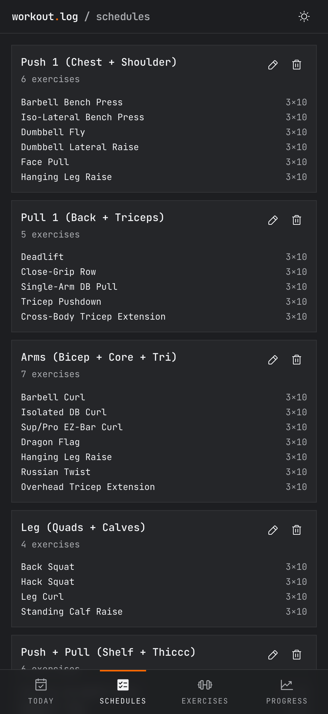 | 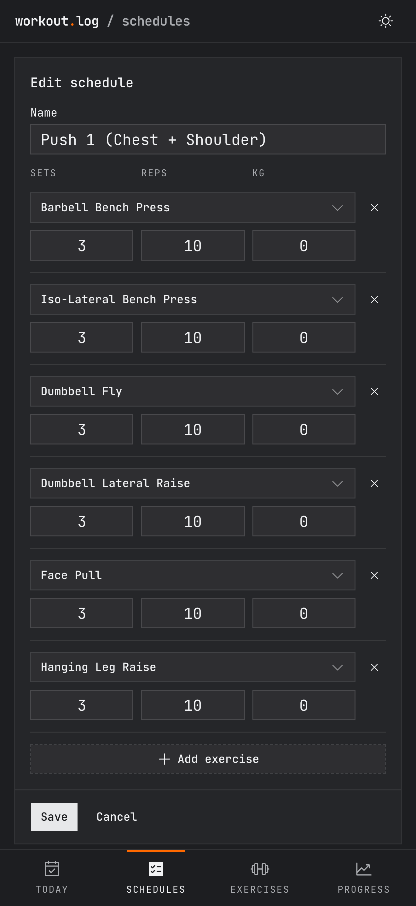 | 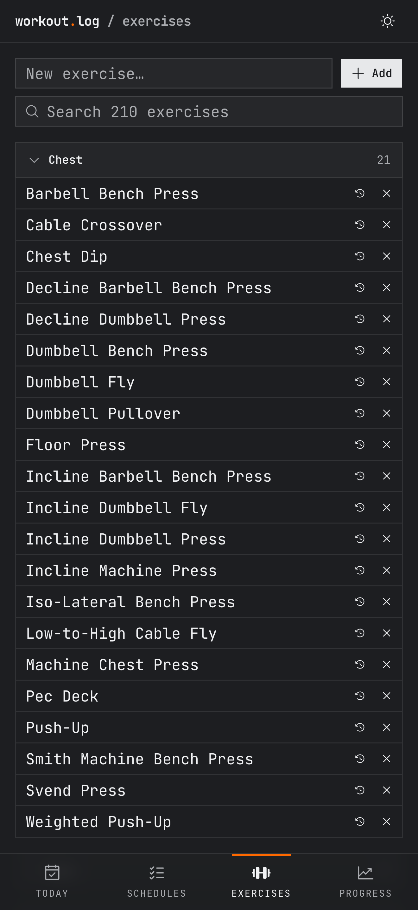 | 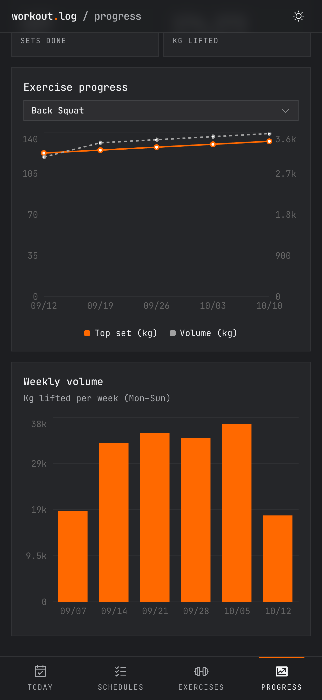 |

| Light: schedules | Light: workout | Light: exercises | Light: progress |
|:-:|:-:|:-:|:-:|
| 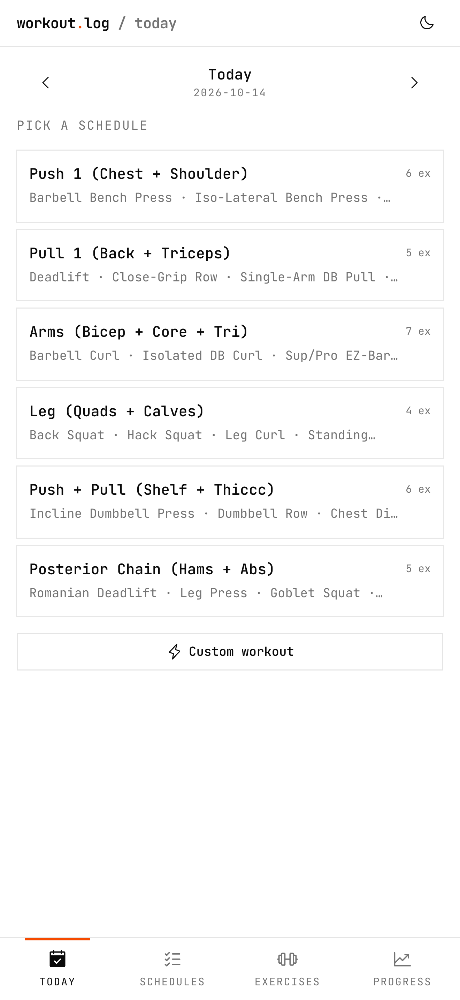 |  | 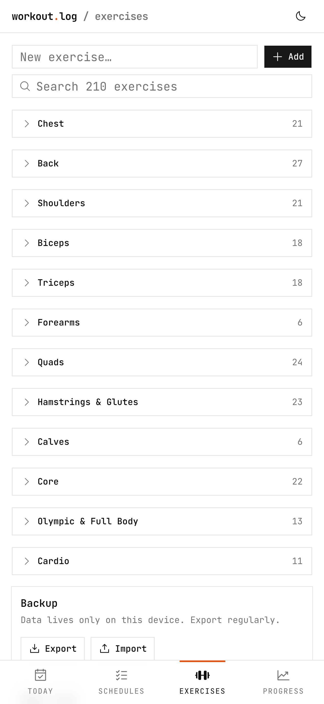 | 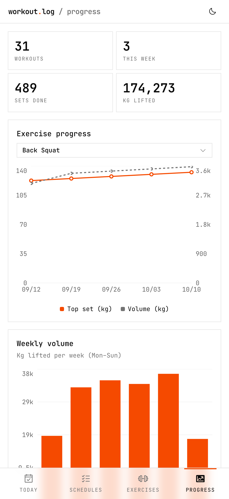 |

## How it's built

- [Next.js](https://nextjs.org) (App Router) as a **static export**: `npm run build` produces plain files in `out/` that any static host can serve.
- Data in the browser's **IndexedDB** (no backend). The exercise library and starter schedules are seeded once per device through database versions (`lib/db.js`).
- [shadcn/ui](https://ui.shadcn.com) components (Radix + Tailwind CSS v4), [Recharts](https://recharts.org) charts via shadcn's chart component, JetBrains Mono font, [Phosphor](https://phosphoricons.com) icons.
- A small service worker precaches the whole build (`scripts/precache.js` lists the files) for offline use.
- Stats, demo-data generation and swipe detection are plain functions with unit tests (`node --test`).

```
app/          page frame, layout, theme
components/   screens (today, schedules, exercises, progress) and shadcn/ui
lib/          db.js (IndexedDB), stats.js, demo.js, exercise-library.js, my-schedules.js
public/       manifest, icon, service worker
scripts/      build-time precache list
```

## Run it

```sh
npm install
npm run dev      # http://localhost:3000 (service worker is off in dev)
npm test         # unit tests
npm run build    # static site in out/
npm start        # serve out/ locally
```

## Deploy

- **Vercel:** import the repo, no settings needed.
- **Netlify / Cloudflare Pages:** build command `npm run build`, publish directory `out`.

Serve it from the root of a domain: the service worker and manifest use `/` paths. Installing and offline mode need HTTPS (or `localhost`).

## Notes

- Data lives only on the device that logged it. Use **Exercises → Backup → Export** regularly.
- `lib/my-schedules.js` holds the starter schedules loaded on first run. Edit it to change what new installs start with (raise the database version in `lib/db.js` to re-seed existing devices).
